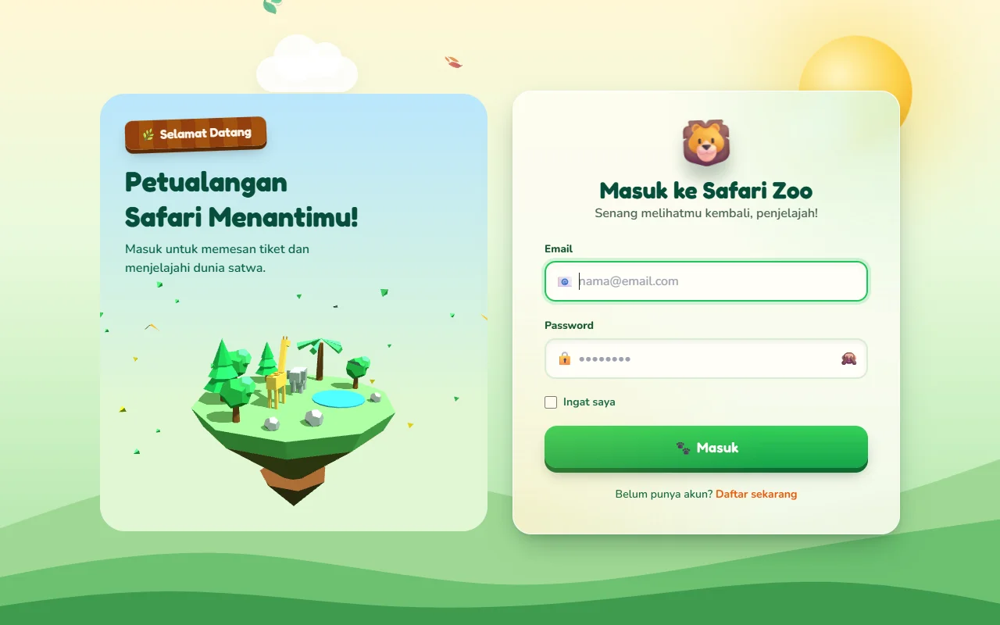
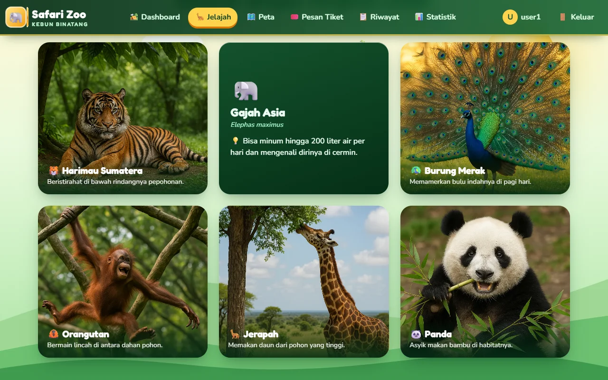
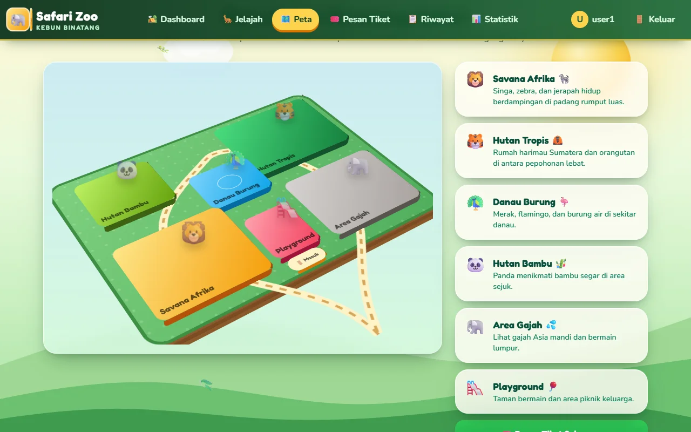
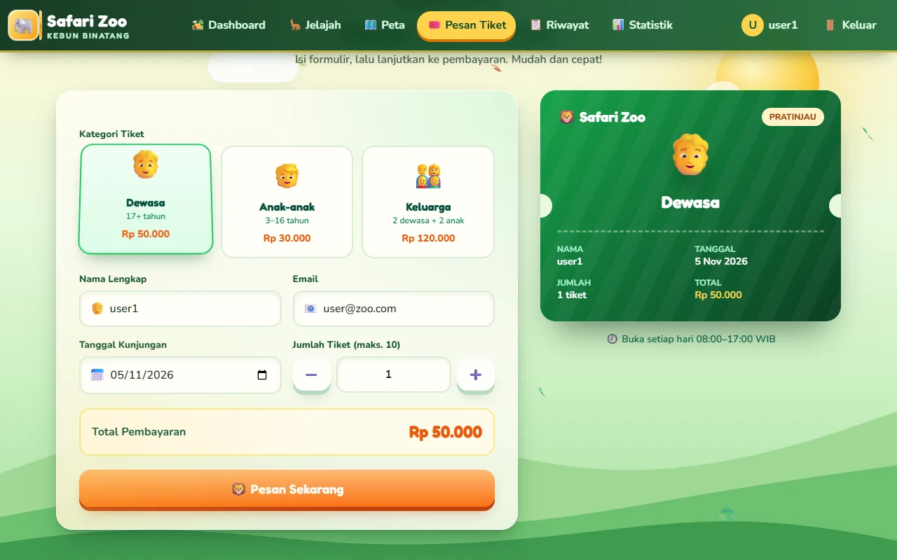
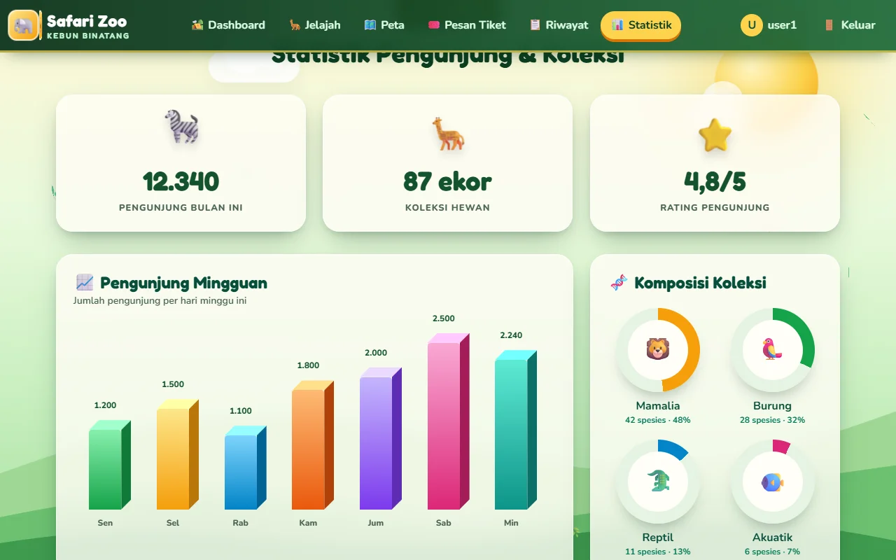
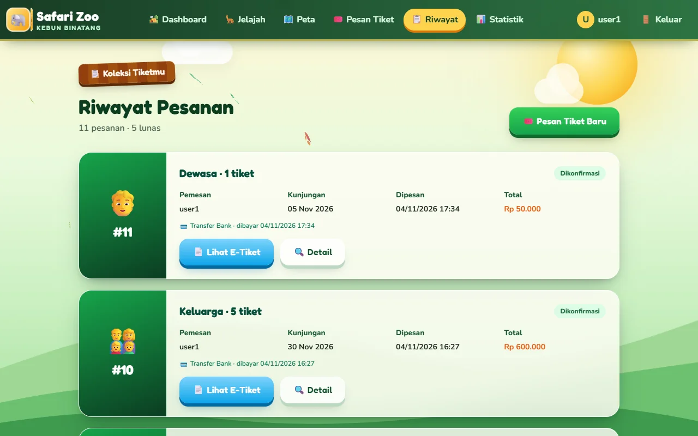
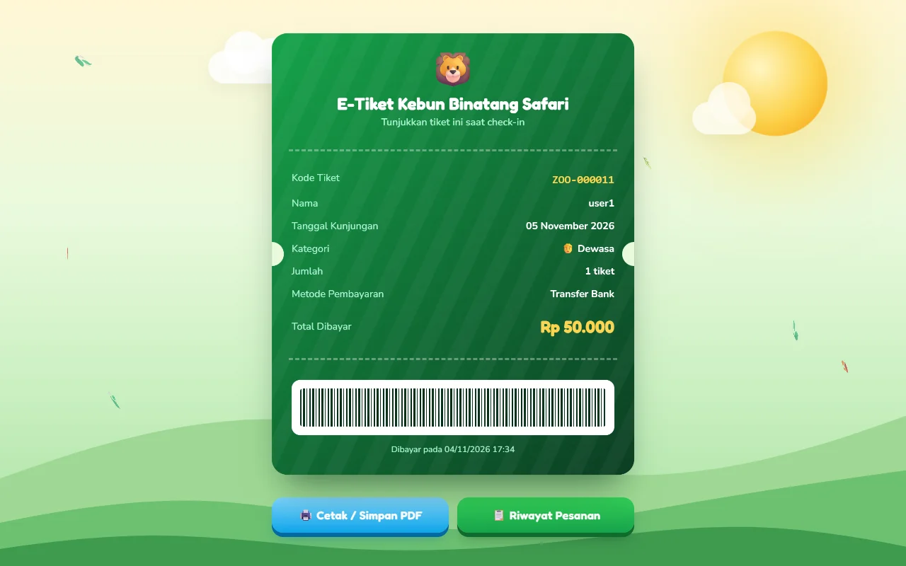
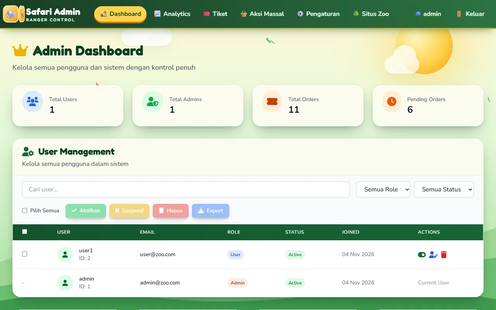
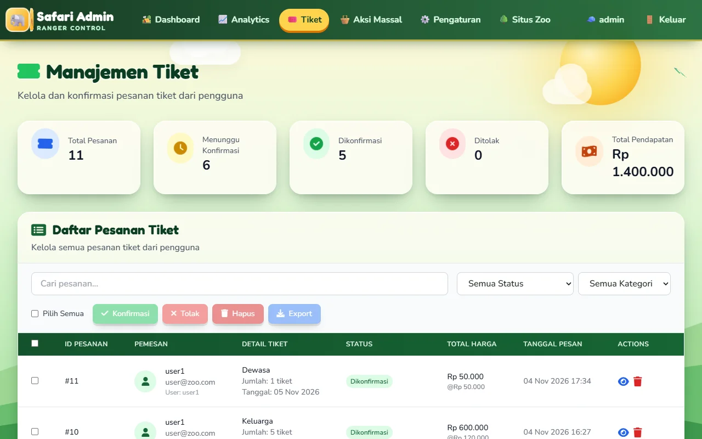

# 🦁 Zoo Management System (Laravel)


Aplikasi web kebun binatang untuk pemesanan tiket online dan panel admin, dibangun dengan **Laravel 12** (PHP 8.2+). Tampilannya bertema hutan safari dengan animasi 3D: pulau low-poly Three.js, peta zona isometrik, kartu hewan yang bisa dibalik, dan diagram batang 3D.

## Tampilan

| Login | Jelajah Satwa (kartu flip 3D) |
|---|---|
|  |  |
| **Peta 3D interaktif** | **Pesan Tiket + pratinjau tiket 3D** |
|  |  |
| **Statistik (diagram batang 3D)** | **Riwayat Pesanan** |
|  |  |
| **E-Tiket siap cetak** | **Admin: Dashboard** |
|  |  |
| **Admin: Manajemen Tiket** | |
|  | |

## Fitur

**Pengunjung**
- Registrasi & login (password di-hash, sesi aman, akun nonaktif otomatis diblokir)
- Pesan tiket (dewasa / anak / keluarga), konfirmasi, simulasi pembayaran
- Riwayat pesanan dan e-tiket yang bisa dicetak / disimpan sebagai PDF
- Profil (ganti nama, password, foto profil), peta & statistik kebun binatang

**Admin** (`/admin`)
- Kelola user: aktif/suspend, ubah role, hapus, tambah user, aksi massal, export CSV
- Kelola pesanan: konfirmasi / tolak / hapus, detail pesanan, aksi massal, export CSV
- Konfirmasi otomatis semua pesanan pending
- Pengaturan harga tiket, sistem (maintenance, maks. tiket per pesanan, jam buka) dan notifikasi — tersimpan di database
- Backup database (.sql) tanpa perlu `mysqldump`
- Analytics user & pesanan, buat akun admin baru

## Instalasi

```bash
composer install
cp .env.example .env
php artisan key:generate
```

Pilih database di `.env`:

- **SQLite** (paling mudah): biarkan `DB_CONNECTION=sqlite`, lalu buat file `database/database.sqlite`.
- **MySQL / XAMPP**: buat database `zoo_management` lalu isi:
  ```env
  DB_CONNECTION=mysql
  DB_HOST=127.0.0.1
  DB_PORT=3306
  DB_DATABASE=zoo_management
  DB_USERNAME=root
  DB_PASSWORD=
  ```

Lalu jalankan:

```bash
php artisan migrate --seed   # buat tabel + akun admin & data contoh
php artisan storage:link     # agar foto profil bisa ditampilkan
php artisan serve            # buka http://127.0.0.1:8000
```

Akun bawaan dari seeder (ubah lewat `ADMIN_EMAIL` / `ADMIN_PASSWORD` di `.env` sebelum seeding):

| Role  | Email          | Password     |
|-------|----------------|--------------|
| Admin | admin@zoo.com  | Admin12345   |
| User  | user@zoo.com   | User12345    |

Membuat / mereset admin dari terminal:

```bash
php artisan zoo:create-admin email@domain.com namaadmin
```

## Email

Secara default `MAIL_MAILER=log`, jadi email konfirmasi/penolakan pesanan ditulis ke `storage/logs/laravel.log`. Isi pengaturan `MAIL_*` di `.env` (mis. SMTP) untuk benar-benar mengirim email.

## Struktur

| Lokasi | Isi |
|---|---|
| `routes/web.php` | Semua URL aplikasi |
| `app/Http/Controllers` | Logika halaman user (`AuthController`, `TicketController`, ...) |
| `app/Http/Controllers/Admin` | Logika panel admin |
| `app/Models` | `User`, `Order`, `Setting`, `LoginLog` |
| `app/Services` | Export CSV, backup database, notifikasi email |
| `resources/views` | Tampilan Blade (`auth/`, `pages/`, `admin/`, `emails/`) |
| `public/assets` | CSS & gambar |
| `database/migrations` | Struktur tabel |
| `storage/app/private` | File export CSV dan backup (tidak bisa diakses publik) |

## Testing

```bash
php artisan test
```

## Lisensi

MIT — lihat [LICENSE](LICENSE).
